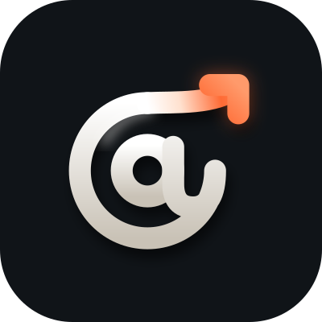
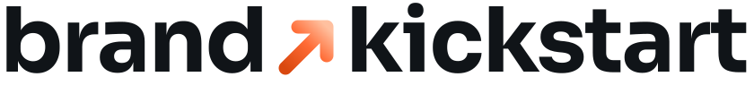
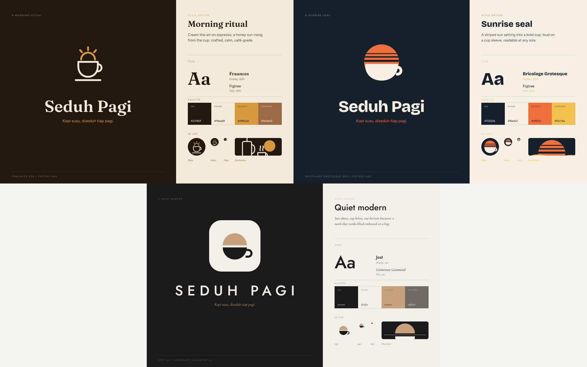
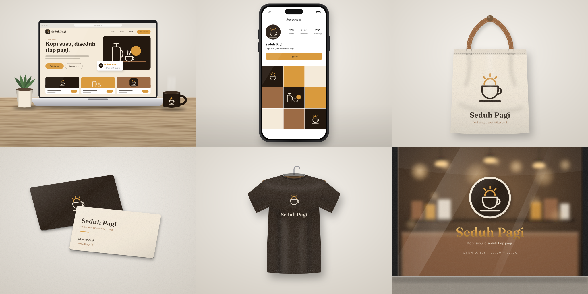
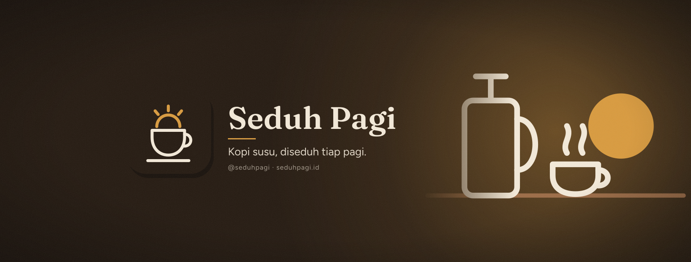
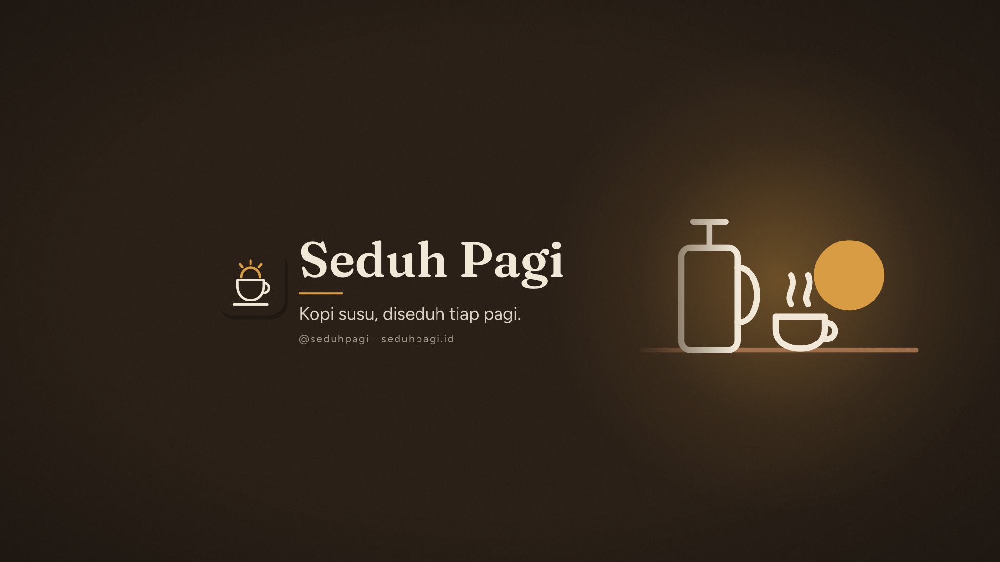
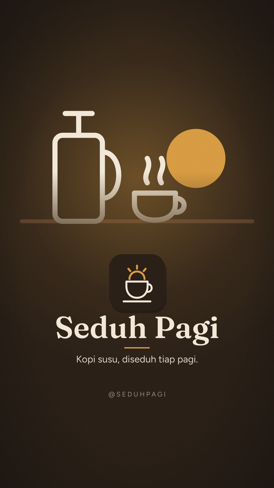

<div align="center">



<h1>
<picture>
  <source media="(prefers-color-scheme: dark)" srcset="docs/brand/wordmark-light.svg">
  
</picture>
</h1>

**From an idea to a launch-ready brand: a name that is free everywhere, then the logo and assets for it.**

[](LICENSE)
[](#optional-package)
[](skills/brand-kickstart/SKILL.md)
[](#what-makes-it-different)

**Checks the same handle on**


**Works in**&nbsp; Claude Code · Codex · Cursor · Google Antigravity · Claude.ai · ChatGPT

[Name check](#why) · [Brand kit demo](#after-the-name-pick-a-style-get-the-kit) · [Gallery](#not-one-house-style) · [Install](#install) · [Use it](#use-it)


</div>

## What it does

An agent skill for any agent that reads `SKILL.md`. It works in two steps:

1. **Name.** Ask your agent for brand or project name ideas. It brainstorms candidates, then checks each one as the *same handle* on every platform above, and as a domain.
2. **Brand.** It then draws style options for the name you pick, and builds the logo, favicons, app icons and social banners. [See the demos.](#after-the-name-pick-a-style-get-the-kit)

```
> Suggest a name for a milk-coffee brand and check IG, TikTok, YouTube and .com/.id

| Platform  |   seduhpagi    |   acmestudio    |
|-----------|:--------------:|:---------------:|
| Display   |   Seduh Pagi   |   Acme Studio   |
| Instagram |       ✅       |       ❌        |
| Threads   |       ✅       |       ❌        |
| Facebook  |      ✅?       |       ✅?       |
| TikTok    |       ✅       |       ❌        |
| YouTube   |       ✅       |       ✅        |
| X         |       ✅       |       ❌        |
| .com      |    ✅ / ✅     |     ❌ / ❌     |
| .id       |    ✅ / ✅     |     ✅ / ✅     |
```

(Real output, 16 Nov 2026.) ✅ available · ❌ taken · ❓ unknown (check manually) · ⛔ not allowed on that platform · ✅? probably free (Facebook) · 🔒 held by the Instagram account (Threads).
Domain cells show `name.tld / hyphenated-name.tld`.

## Why

Handles end up inconsistent (`@acmestudio.id` on Instagram, `@acmestudio-id` on YouTube) because each platform gets checked by hand, one at a time, after the name is already chosen. This skill moves that check to the moment you choose.

## What makes it different

- **It never guesses.** A platform that gives no clear signal is reported as ❓ unknown, with a link. Many checkers report "taken" whenever a page loads, so free names get thrown away.
- **Nothing to install for the checks.** Every name check, Instagram and Facebook included, uses only the Python 3.9+ standard library. No browser, no login, no API keys. Only the brand kit renderer needs one 2 MB package.
- **Rate-limit aware.** Requests to the same platform are paced and retried once on HTTP 429/503. A platform that keeps limiting is stopped and reported, not hammered.
- **Domains via the real registry.** RDAP goes to each TLD's own registry (IANA bootstrap). When a registry has no RDAP or it fails, the checker falls back to that registry's WHOIS, so `.io`, `.co`, `.co.id`, `.de`, `.jp` and others work too.

## After the name: pick a style, get the kit

Once you pick a name, the agent draws **3 style options** for you to choose from. Each option has its own logo, illustration, typefaces and palette. Every board shows the logo at 128, 44 and 16 px, cropped to a circle the way every platform shows it.

> Make a logo and banners for Seduh Pagi



Pick one (or mix: "B's mark with A's colors"). The agent first shows the logo in real places, so you can judge it before anything else is made:



Then it builds a `brand/` folder with a brand guide, [`BRAND.md`](docs/demo/seduh-pagi/BRAND.md). The guide has the logo rules, the palette with contrast ratios, the fonts, the mockups, and every file with where to upload it:

```
brand/
  BRAND.md   the brand guide (logo, palette, fonts, mockups, file list)
  mockups/   website, social profile, tote bag, business card, T-shirt, shop window
  logo/      logo-1080.png (profile picture), logo-512.png
  favicon/   favicon.ico, favicon.svg, apple-touch-icon.png, icon-192/512.png, site.webmanifest, head.html
  app/       app-store-1024.png (no alpha), play-store-512.png
  social/    youtube-banner, facebook-cover, x-header, video-cover, highlight covers, ...
```



<table>
<tr>
<td width="72%"></td>
<td></td>
</tr>
<tr>
<td align="center"><sub><b>YouTube banner</b> · 2560 × 1440 · text inside the TV-to-phone safe area</sub></td>
<td align="center"><sub><b>Video cover</b> · 1080 × 1920</sub></td>
</tr>
</table>

### Not one house style

The agent picks from a menu in [`references/styles.md`](skills/brand-kickstart/references/styles.md), matched to the brief: 43 font pairings, 16 palettes, 9 mark types, 3 rendering styles (flat, 2.5D, 3D), text-based logos (wordmark, lettermark, combination) and 6 banner layouts. A 2.5D or 3D logo comes with a flat version for favicons, so it still reads at 16 px. A wordmark is drawn once and used wherever the name appears. Twelve made-up brands, twelve very different results (the gallery at the top of this page):

```console
$ brand.py board docs/demo/gallery

  BRAND           BRIEF                LOGO          RENDER   MARK
  ─────────────── ──────────────────── ───────────── ──────── ─────────────────────────────────────
  Maison Vérane   perfume house        symbol        flat     Didone V in a hairline arch
  Kaldera         outdoor gear         symbol        flat     caldera cut into a peak
  Selasar         architecture studio  symbol        flat     four arches, one terracotta
  ombak           swimwear             emblem        flat     sun, surf and sea in one coin
  Teduh           tea house            symbol        flat     a single veined leaf
  Arunika         investing app        abstract      flat     a sun built from rising bars
  Kotak Kita      moving and storage   symbol        2.5D     a taped box in true isometric
  Embun           skincare             symbol        3D       a glassy dewdrop with real light
  gema            podcast network      wordmark      flat     the name with three echo arcs
  TUMPUK          board game café      wordmark      2.5D     caps extruded like game pieces
  nyala           AI app               wordmark      3D       glossy candy-gradient letters
  Wirya & Rekan   law firm             lettermark    flat     W R between brass rules

  ✓ 12 boards · logo at 128, 44 and 16 px · palette · type · illustration
```

> [!NOTE]
> Every logo, illustration and mockup on this page was drawn by **Claude Opus 5.5** running the skill. The agent writes the SVG itself, so the quality of the logos depends on the model you use: a smaller or older model follows the same rules but draws simpler, rougher marks.

Every logo and illustration is drawn from scratch as SVG: no emoji, no icon fonts, no clip-art, no image model. It is rendered with [resvg](https://github.com/linebender/resvg) (`pip install resvg-py`, 2 MB), so no browser is needed. The full flow is in [`references/brand-kit.md`](skills/brand-kickstart/references/brand-kit.md). The images in this README are plain SVG, rebuilt from source with `python docs/demo/build.py`.

## Install

### Easiest: ask your agent

Paste this into Claude Code, Codex, Cursor, Antigravity or any agent that can run shell commands:

```text
Install the agent skill from https://github.com/M-Julius/brand-kickstart for yourself.
Clone the repo to a temporary folder and copy its skills/brand-kickstart folder into your
personal skills directory (Claude Code: ~/.claude/skills/, Codex: ~/.codex/skills/,
Cursor: ~/.cursor/skills/, Antigravity: ~/.gemini/config/skills/). Do not install any
Python package yet. Then tell me to restart you, and show me how to use the skill.
```

The other options below install the same folder, `skills/brand-kickstart`.

### Any agent, with the skills CLI

```bash
npx skills add M-Julius/brand-kickstart
```

The [skills CLI](https://github.com/vercel-labs/skills) detects the agents you have (Claude Code, Codex, Cursor, OpenCode and more) and asks where to install it. Add `-g` to install it for all projects.

### Claude Code, as a plugin

```
/plugin install brand-kickstart --marketplace M-Julius/brand-kickstart
```

On Claude Code older than 2.1.275, run `/plugin marketplace add M-Julius/brand-kickstart`, then `/plugin install brand-kickstart@brand-kickstart`. Plugin updates arrive through `/plugin`.

### Claude.ai and ChatGPT, by upload

Download the zip for your app from the [latest release](https://github.com/M-Julius/brand-kickstart/releases/latest) and upload it:
- **Claude.ai**: `brand-kickstart.zip`, in Settings → Capabilities → Skills → Upload skill.
- **ChatGPT**: `brand-kickstart-chatgpt.zip`, uploaded as a plugin. ChatGPT needs the `skills/brand-kickstart/` layout, so the Claude.ai zip is refused there.

The repository's own "Download ZIP" contains a lot more than the skill. Use the release zips instead.

These apps run the scripts in a sandbox, so two limits apply:
- **Name checks need internet access.** On Claude.ai, "package managers only" network access lets npm and PyPI through but blocks the social platforms and the domain lookup. Allow all domains for code execution in Settings. Even then, Instagram, Threads and GitHub may limit the shared sandbox IP. Anything the sandbox cannot reach shows ❓ with a link rather than a guess. Running the check on your own machine gives full results.
- **The brand kit needs `resvg-py`.** The sandbox may not be able to install it. If so, the agent still writes the SVG files, and you can render them on your own machine with `brand.py render`.

### Manual: copy or symlink

```bash
git clone https://github.com/M-Julius/brand-kickstart.git
ln -s "$PWD/brand-kickstart/skills/brand-kickstart" ~/.claude/skills/brand-kickstart
```

| Agent | Personal (all projects) | One project |
|---|---|---|
| Claude Code | `~/.claude/skills/` | `.claude/skills/` |
| Codex | `~/.codex/skills/` | `.codex/skills/` |
| Cursor | `~/.cursor/skills/` (Cursor also reads `~/.claude/skills/`) | `.cursor/skills/` |
| Google Antigravity | `~/.gemini/config/skills/` | `.agents/skills/` |

Restart the agent after installing.

### Optional package

Name checks need only Python 3.9+. Rendering the brand kit to PNG needs `resvg-py` (2 MB, no other dependencies):

```bash
python3 -m pip install resvg-py
# or, if pip refuses ("externally managed environment"):
python3 -m venv ~/.venvs/brand-kickstart && ~/.venvs/brand-kickstart/bin/pip install resvg-py
```

The agent asks before it installs it.

## Use it

You can just describe what you need. The agent loads the skill when the request is about naming a brand, checking a handle or a domain, or making a logo. To call it directly:

| Agent | Call it with |
|---|---|
| Claude Code | `/brand-kickstart` (installed as a plugin: `/brand-kickstart:brand-kickstart`) |
| Codex | `$brand-kickstart` |
| Cursor, Antigravity, Claude.ai, ChatGPT | ask in plain words, e.g. "use the brand-kickstart skill" |

Prompts to try:

```text
I'm opening a milk-coffee shop in Bandung. Suggest 10 names and check IG, TikTok, YouTube, .com and .id.
```
```text
Is "acmestudio" free everywhere? Also try variants like acme.studio and acmestudio.id.
```
```text
I'm naming an open-source CLI for deploying scripts. Check GitHub, npm, PyPI and .dev.
```
```text
We picked "Seduh Pagi". Draw 3 logo styles to choose from, then make the profile picture, favicons and a YouTube banner.
```
```text
Always check .id for me and never check X. Save that as my default.
```

A session usually goes like this:
1. The agent asks what you are naming and for whom.
2. It suggests names and shows a table of where each one is free.
3. You pick a name, and it offers style options for the logo.
4. You pick a style, and it builds the `brand/` folder.

## Use it without an agent

```bash
python3 skills/brand-kickstart/scripts/check.py "Acme Studio" seduhpagi --tlds com,id
python3 skills/brand-kickstart/scripts/check.py acmestudio --mode project --variants
python3 skills/brand-kickstart/scripts/check.py --self-test
```

| Flag | Meaning |
|---|---|
| `--mode brand\|project\|all` | Which platform set to check (default `brand`) |
| `--platforms ig,tiktok,yt` | Exact list; overrides `--mode` |
| `--skip x,github` | Leave platforms out |
| `--tlds com,id` | Domain extensions (default `com`) |
| `--no-domains` | Skip domains |
| `--variants` | Also try separators and common affixes, max 12 per name |
| `--country id` | Adds `name.id` / `name_id` variants |
| `--json` | Machine-readable output |
| `--self-test` | Live check that every platform still behaves as expected |

| Mode | Platforms |
|---|---|
| `brand` | Instagram, Threads, Facebook, TikTok, YouTube, X |
| `project` | GitHub, npm, PyPI, Product Hunt, X |
| `all` | all of the above |

Names may contain spaces and capitals (`"Acme Studio"` is checked as `acmestudio` and shown as the display name). Exact handles keep their separators (`acmestudio.id`).

The brand kit renderer works on a folder the agent wrote (see [`brand-kit.md`](skills/brand-kickstart/references/brand-kit.md)):

```bash
python3 skills/brand-kickstart/scripts/brand.py fonts brand "Fraunces:wght@600" "Figtree:wght@400"
python3 skills/brand-kickstart/scripts/brand.py board brand     # style options to pick from
python3 skills/brand-kickstart/scripts/brand.py pick brand a-morning-ritual --handle seduhpagi --domain seduhpagi.id
python3 skills/brand-kickstart/scripts/brand.py render brand     # favicons, app icons, banners
```

### Saved preferences

Optional `~/.config/brand-kickstart/config.json` (path overridable with `BRAND_KICKSTART_CONFIG`):

```json
{ "mode": "brand", "skip": ["x"], "tlds": ["com", "id"], "country": "id" }
```

Command-line flags override it.

## Limits

- **Threads** handles belong to Instagram accounts. When the Instagram account exists but has not turned on Threads, the Threads page is an error page, and the checker shows 🔒 with a link to that Instagram profile. If it is yours, turn on Threads; no one else can take the name.
- **Facebook** can only confirm *taken* names. A name it cannot find is shown as ✅? (probably free), because an age-restricted page (alcohol, tobacco) looks exactly like a free name to anyone who is not logged in.
- **Product Hunt** sits behind a Cloudflare challenge. It is shown as 🔗 with a "check yourself" link, and it does not count against a name.
- **Banned or deactivated accounts** can still hold a handle, and a public check cannot see that. Register your winning name right away; the signup form is the final word.
- **Platforms change.** A weekly CI canary (`--self-test`) opens an issue when a platform stops behaving as expected. Fixes are usually a one-line change to `platforms.json`.

## Contributing

Adding or fixing a platform is usually one JSON entry plus two fixture files. New font pairings, palettes and demo brands are welcome too. See [CONTRIBUTING.md](CONTRIBUTING.md).

## License

MIT. Not affiliated with any of the platforms checked.
