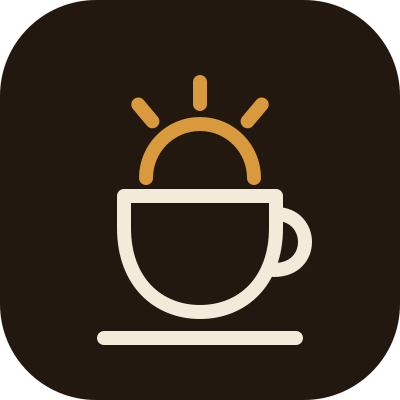
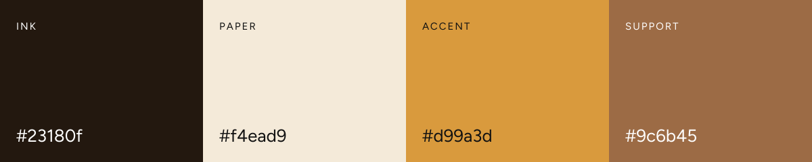
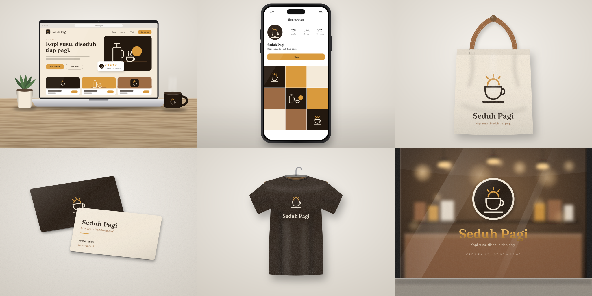

# Seduh Pagi

> Kopi susu, diseduh tiap pagi.

**Handle:** @seduhpagi · **Domain:** seduhpagi.id · **Style:** Morning ritual (`a-morning-ritual`)

Cream line art on espresso, a honey sun rising from the cup: crafted, calm, café-grade.

## Logo

- `logo.svg`: the master file. Every PNG is rendered from it.
- `mark.svg`: the mark without its background, for merch and print
- `illustration.svg`: the brand illustration for banners and covers
- **Clear space:** keep empty space around the logo of at least a quarter of its width.
- **Minimum size:** 16 px on screen (it is drawn to read at favicon size), 15 mm in print.
- **Backgrounds:** use it on ink or paper. On photos, put it on a solid ink or paper block.
- **Do not:** stretch it, recolor it outside the palette, add shadows or outlines, or rotate it.

## Colors

| Role | Hex | RGB | Use |
|---|---|---|---|
| Ink | `#23180f` | 35, 24, 15 | Text and dark backgrounds |
| Paper | `#f4ead9` | 244, 234, 217 | Light backgrounds |
| Accent | `#d99a3d` | 217, 154, 61 | Buttons, links and highlights; keep it to about 10% of a layout |
| Support | `#9c6b45` | 156, 107, 69 | Secondary text, lines and details |

Contrast (WCAG; body text needs 4.5:1 or more):
- Ink on paper: 14.6:1
- Accent on ink: 7.1:1
- Accent on paper: 2.0:1 (too low for body text; large text or decoration only)
- Support on paper: 3.8:1 (too low for body text; large text or decoration only)

## Typography

| Role | Font | Weight | Get it |
|---|---|---|---|
| Display | Fraunces | 600 | https://fonts.google.com/specimen/Fraunces |
| Text | Figtree | 400 | https://fonts.google.com/specimen/Figtree |

Wordmark: Fraunces, default letter-spacing. Write the name as **Seduh Pagi**.

## Mockups

Website, social profile, tote bag, business card, T-shirt and shop window. The sources are in `mockups/`.

## Files

| File | Where it goes |
|---|---|
| `logo/logo-1080.png` | Profile picture on every platform |
| `logo/logo-512.png` | Website header, documents, email signature |
| `social/facebook-cover-1640x624.png` | Facebook Page: Edit cover photo |
| `social/github-social-preview-1280x640.png` | GitHub repo: Settings, Social preview |
| `social/ig-highlight-1080x1920.png` | Instagram: Highlight, Edit cover |
| `social/video-cover-1080x1920.png` | Cover for TikTok, Reels and Shorts |
| `social/x-header-1500x500.png` | X: Edit profile, Header |
| `social/youtube-banner-2560x1440.png` | YouTube Studio: Customization, Branding, Banner image |
| `favicon/` (9 files) | Copy to the website root, then paste `favicon/head.html` into `<head>` |

---
Generated by brand-kickstart. Change `brand.json` or the SVG files, then run `brand.py render` again.
